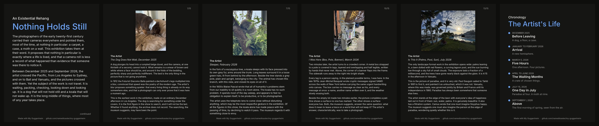
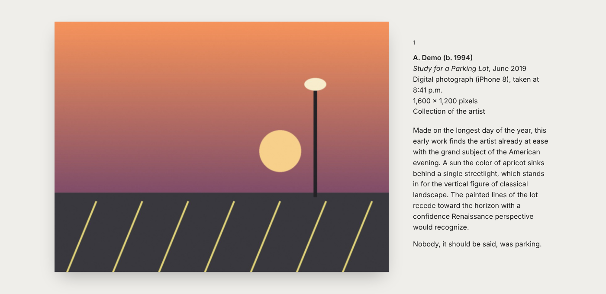
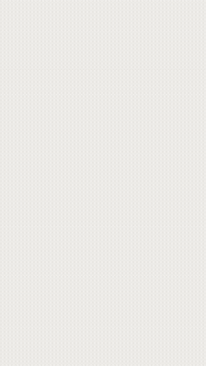
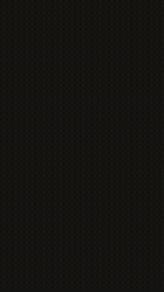

```
  __  __          ____                              _          _
 |  \/  |_   _   / ___|_   _  __ _  __ _  ___ _ __ | |__   ___(_)_ __ ___
 | |\/| | | | | | |  _| | | |/ _` |/ _` |/ _ \ '_ \| '_ \ / _ \ | '_ ` _ \
 | |  | | |_| | | |_| | |_| | (_| | (_| |  __/ | | | | | |  __/ | | | | | |
 |_|  |_|\__, |  \____|\__,_|\__, |\__, |\___|_| |_|_| |_|\___|_|_| |_| |_|
         |___/               |___/ |___/
```

## Your camera roll, curated like a museum.

**Give Claude any photos. Get back a museum exhibition of your own life.** Wall texts
for every picture, written with complete sincerity. A timeline of "The Artist's Life"
built from when and where you took them. A gallery page, a carousel to post, a story
cover and a short vertical film.

The more random the photos, the better. A parking lot at sunset. A receipt. A blurry
pigeon. A screenshot from 11:58 p.m.

    



<p align="center"><b>See a real one:</b> <a href="showcase/nothing-holds-still/README.md"><i>Nothing Holds Still</i></a>, fifteen photos from one year, in the Existential mood.</p>

## Why

I was standing in the Guggenheim in New York reading a wall text that said the
artists of the early 1900s endeavored "to infuse their work with a transcendent
spirit capable of transmuting everyday existence." And I realised how not silly, and
also kind of silly, museums are.

When I was younger I tried to *win* at museums. Read every label, understand every
word, solve every exhibit. Now I read what I can, without putting any stress on it,
and get what I get.

So: what if everyone's ordinary photos got the full museum treatment? Earnest. A
little ridiculous. And, under the big words, actually noticing what you noticed.

## Start

### Claude Code

```
/plugin marketplace add namedtoaster/my-guggenheim
/plugin install my-guggenheim@my-guggenheim
```

Then:

```
/exhibit ~/Pictures/some-folder
```

> [!TIP]
> **Send a zip.** Photos attached one by one in a chat app usually arrive without
> their date and place. Zip them first and attach the zip: the originals, with all
> their data, come through, and the timeline builds itself. iPhone HEIC photos and
> short videos work too.

### On your phone, or Claude Code on the web

Fork this repo, open it in [Claude Code on the web](https://claude.ai/code) or the
Claude app, attach a zip of your photos and say **"make my exhibit"**. The skill is already in
the repo (`.claude/skills/exhibit`), so there is nothing to install. Your photos stay
in the session and are never committed (`exhibits/` is ignored).

### claude.ai and the Claude app (chat)

1. Get the skill zip: download `my-guggenheim-exhibit.zip` from
   [Releases](https://github.com/namedtoaster/my-guggenheim/releases), or build it
   with `python3 scripts/package_skill.py`.
2. In claude.ai, turn on code execution and upload the zip as a skill (Settings,
   then Capabilities or Skills, depending on your plan).
3. In any chat, attach a zip of photos and say **"make my exhibit"**.

### Other agents

Cursor, Codex, Gemini CLI and others that read skills:

```
npx skills add namedtoaster/my-guggenheim
```

## What you get

| File | For |
| --- | --- |
| `gallery/index.html` | The exhibition. One file with the photos inside: open it, send it, host it |
| `share/01-wall-text.png` ... | A carousel at 1080x1350: the intro wall, one card per work, the timeline |
| `share/story-cover.png` | A 1080x1920 cover for Stories |
| `share/film-vertical.mp4` | A 30 to 60 second film for Reels, TikTok and Shorts. Silent, so you pick the sound |
| `share/trailer-vertical.mp4` | A 30 to 40 second trailer: the photos full frame, the best lines from the labels set large on black, a montage and the title. Made on request |
| `share/caption.txt` | A caption with `#MyGuggenheim` and the link to make your own |
| `share/wall-texts.md` | Every word of the show, to read anywhere without the photos |

<table>
<tr>
<td width="62%"></td>
<td></td>
</tr>
</table>

## How it works

1. **It reads your photos.** Dates, camera, rough place and colors, from the photo
   data and file names. Then Claude looks at every picture.
2. **It asks one short question** if the dates or places got lost (chat apps often
   strip them): roughly when, roughly where, how to credit you, which tone.
3. **It curates.** A title, an intro wall, a label for each work, and the timeline:
   your Early Period, the Chicago Years, the Screenshot Period, Late Style.
4. **It builds** the gallery, the cards and the film, and checks its own work.

**Pick a mood, any mood.** Museum is the default. Ask for **Existential** (black walls,
Rothko, Camus, gently withheld answers), **Noir**, **Tender**, **Deadpan**, **Romantic**,
**Far future** (a museum in 3026 misreading your phone), **For kids**, or anything in your
own words: "like a nature documentary", "my grandmother wrote it", "sad but funny".
The mood changes the writing, the art history it reaches for, and even the color of
the walls.

## From a real exhibition

*Nothing Holds Still* is the author's own camera roll, from Los Angeles to Sydney,
Bali and Vanuatu, curated in the Existential mood. Every face, name and number plate
is blacked out.

<table>
<tr>
<td></td>
<td>

> **Ground (Grey)**, 2025
>
> A carpet, seen from directly above, extends to every edge of the frame and, we
> must assume, beyond it. There is no horizon. ... Much of any year is spent
> looking at the floor, waiting for the next thing. The artist looked, and then
> took a picture of it. That is not nothing. It may be most of it.

**[Read the whole exhibition](showcase/nothing-holds-still/README.md)** ·
[Open the gallery page](https://namedtoaster.github.io/my-guggenheim/showcase/nothing-holds-still/gallery/)

</td>
</tr>
</table>

## A label from the demo

> **Pigeon, Possibly**, October 2026
> Digital photograph (iPhone 15)
>
> The most recent work in the collection is also its most contested. A grey form,
> softened almost to vapor, holds still for exactly as long as the shutter needs and
> not a moment longer. Its orange eye is the only point of focus in the picture.
> Scholars agree it is a bird. Beyond that, consensus collapses. In the artist's late
> style, the subject is less important than the attempt.

Try the whole demo yourself: see [examples/README.md](examples/README.md).

## Your photos stay yours

**My Guggenheim does not collect, store, upload or sell anything about you.** No
server, no account, no analytics, no tracking.

- The scripts run where you run them and contain no networking code. They work offline.
- Your originals are never changed. Shared copies have camera data and GPS removed.
- Places are named at city level at most. Faces and names can be blacked out first.
- The gallery page loads nothing from the internet.
- This repo never holds your photos or personal details, and every commit is checked
  to keep it that way. (The showcase is the author's own, published by choice.)

Read the whole promise, including what it can't cover, in [PRIVACY.md](PRIVACY.md).

## Want more motion?

Ask for **a trailer**. It cuts the show like a film trailer: one line from a
label at a time on black ("The coffee was meant to be drunk. The picture was
taken instead."), cards like SIX WORKS. EIGHT YEARS. ONE ARTIST., a fast montage of
every photo, then the title. Add a dramatic sound in the app you post from.

```
python3 skills/exhibit/scripts/make_trailer.py exhibits/your-show
```

The built in film works everywhere. For fancier motion design, the same
`exhibition.json` can drive a [Remotion](https://www.remotion.dev) video in Claude
Code. See [skills/exhibit/references/film.md](skills/exhibit/references/film.md).

## Show us

Post your show with **#MyGuggenheim**, then
[add the link](https://github.com/namedtoaster/my-guggenheim/issues/new?template=share-exhibition.yml)
to [On view elsewhere](COMMUNITY.md). Only links go there: your photos stay on your own
account, never in this repo. If the curator ever says something unkind, wrong or too
revealing, [tell us](https://github.com/namedtoaster/my-guggenheim/issues/new?template=the-curator-said.md)
and the voice guide gets better for everyone.

## Why I made this

Read the [philosophy](PHILOSOPHY.md), then [share your own museum story](https://github.com/namedtoaster/my-guggenheim/issues/new?template=my-story.yml).
The best ones go in [STORIES.md](STORIES.md).

## Contributing

New tones, better cards, film styles, and labels that made you laugh are all welcome.
See [CONTRIBUTING.md](CONTRIBUTING.md).

## Not a real museum

My Guggenheim is a personal project inspired by a visit to the museum. It is not
affiliated with or endorsed by the Solomon R. Guggenheim Foundation or any museum,
and the exhibitions it makes say so.

## License

MIT. See [LICENSE](LICENSE). The bundled Inter font is under the SIL Open Font
License ([skills/exhibit/assets/fonts/OFL.txt](skills/exhibit/assets/fonts/OFL.txt)).
