> A real exhibition made with My Guggenheim from one person's camera roll, in the Existential mood. Faces, names, number plates and other personal details are blacked out, and no image carries camera or location data.
>
> [Open the gallery page](https://namedtoaster.github.io/my-guggenheim/showcase/nothing-holds-still/gallery/) · [Back to My Guggenheim](../../README.md)

*An Existential Rehang*

# Nothing Holds Still

The photographers of the early twenty-first century carried their cameras everywhere and pointed them, most of the time, at nothing in particular: a carpet, a case, a moth on a wall. This exhibition takes them at their word. It proposes that nothing in particular is exactly where a life is lived, and that a camera roll is less a record of what happened than evidence that someone was there to notice it.

Between December 2025 and September 2026, the artist crossed the Pacific, from Los Angeles to Sydney, and on to Bali and Vanuatu, and the pictures crossed with them. Yet the subject of the work is not travel. It is waiting, packing, checking, looking down and looking up. It is a dog that will not hold still and a koala that will not wake up. It is the long middle of things, where most of any year takes place.

The work stands in a tradition of art that sits with uncertainty instead of resolving it: Mark Rothko's dark late paintings, Edward Hopper's rooms in which someone waits for something that does not arrive, the date paintings of On Kawara, which say only that a day happened. Albert Camus wrote that the absurd is born of the meeting between our need for meaning and the silence of the world. This rehang does not try to break that silence. It suggests that a photograph is one of the ways we keep each other company inside it. The museum is aware that this is a great deal to ask of a picture of a carpet.

Drawn from the artist's camera roll, *Nothing Holds Still* explores a year in which the artist kept choosing, again and again, to notice. It does not say what any of it means. It suggests only that the noticing was not nothing.

---

## Before Leaving
*December 2025*

The first room holds the last weeks in Los Angeles. Nothing dramatic happens in it. A dog searches a bed, a carpet is looked at, a case is packed. This is how most departures look from the inside: not like an ending, but like a series of ordinary evenings in which something is quietly being decided. Look for the closed things in this room, and for the one figure who is searching.

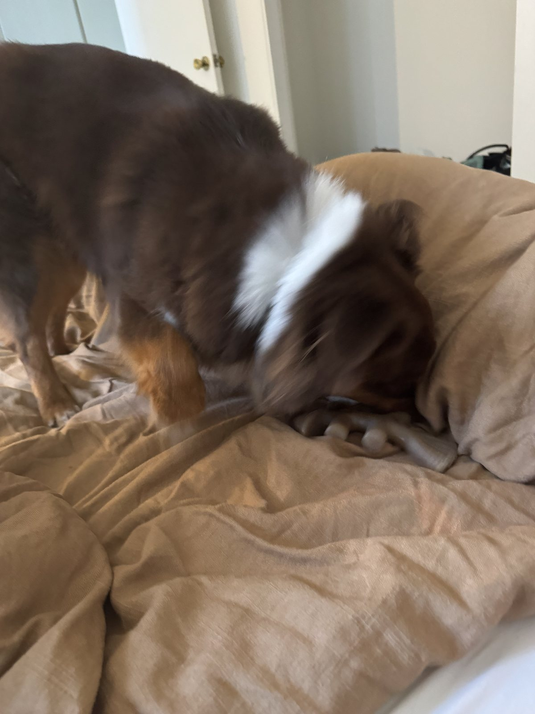

### 1. The Dog Does Not Wait, December 2025

*Digital photograph (iPhone 15 Pro Max), 1/30 second, taken at 2:20 p.m.*  
*4,284 × 5,712 pixels. Collection of the artist.*

A dog plunges its head into a rumpled beige duvet, and the camera, at one thirtieth of a second, cannot hold it. What remains is a smear of brown and white where a face should be, and around it the folds of the bedding, perfectly sharp and perfectly indifferent. The bed is the only thing in the picture that is not going anywhere.

In 1912 the Futurist Giacomo Balla painted a dachshund's legs multiplied into a blur, convinced that speed was the poetry of the modern age. The artist's blur proposes something quieter: that every living thing is already on its way somewhere else, and that a photograph can only ever prove that it was here a moment ago.

This is the earliest work in the exhibition, made on an ordinary December afternoon in Los Angeles. The dog is searching for something under the covers. It is the first figure in the show to search, and it will not be the last. Whether it found anything, the archive does not record. The searching, the museum suggests, may have been the point.

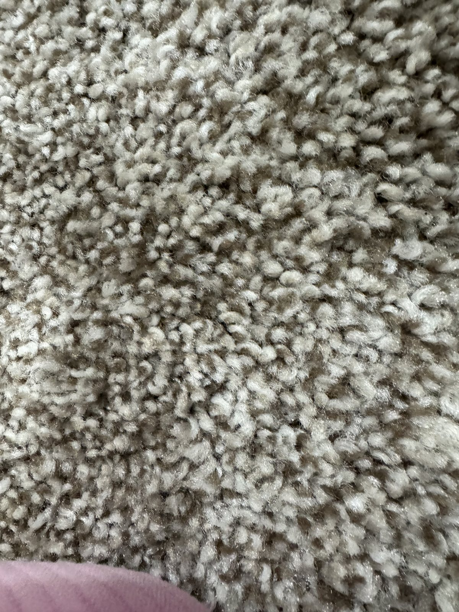

### 2. Ground (Grey), December 2025

*Digital photograph (iPhone 15 Pro Max, ultra wide lens), ISO 800, taken at 2:59 p.m.*  
*3,024 × 4,032 pixels. Collection of the artist.*

A carpet, seen from directly above, extends to every edge of the frame and, we must assume, beyond it. There is no horizon. There is no furniture, no door, no indication of where the room ends or why it began. Thousands of identical grey loops each cast their own small shadow, as if each had been asked to account for itself and could not. At the lower edge, a single pink shape, a sock perhaps, confirms that someone is standing here, and that they have looked down.

Mark Rothko spent his last years painting fields of dark color that offer the eye nowhere to rest and nothing to hold. Standing before them, visitors report a feeling that is hard to name and harder to leave. The artist's carpet produces a related effect at a fraction of the scale. It is an all over surface, a field without a figure, and the figure, when it arrives, is only a foot.

Camus asked us to imagine Sisyphus happy, pushing his rock up the hill forever. The carpet asks something smaller. Much of any year is spent looking at the floor, waiting for the next thing. The artist looked, and then took a picture of it. That is not nothing. It may be most of it.

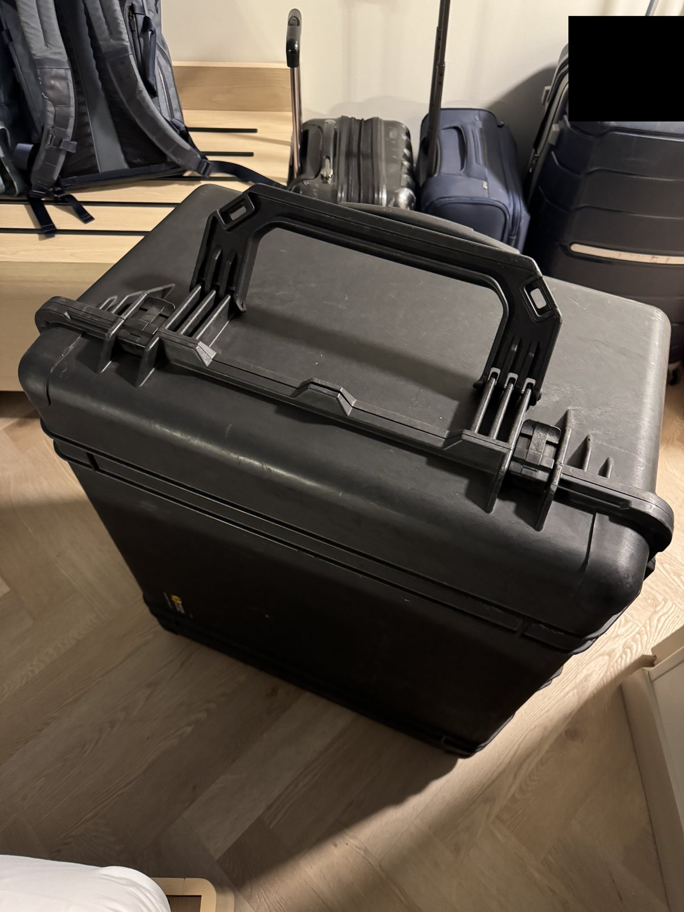

### 3. Case, Packed, December 2025

*Digital photograph (iPhone 15 Pro Max), ISO 1000, taken at 8:54 p.m. Details redacted for public display.*  
*4,284 × 5,712 pixels. Collection of the artist.*

A black hard case, shut and latched, waits on a pale wooden floor. Behind it a row of suitcases leans against the wall like people at a bus stop, each one closed around its own contents. A corner of white bedding enters the frame. It is 8:54 in the evening. Nothing in the room is unpacked, and nothing in the room has left.

Samuel Beckett's *Waiting for Godot* (1953) gives us two figures who wait for someone who never comes, and who say "Let's go" and do not move. The case is their opposite. It knows exactly where it is going. Only the person who packed it must decide, again in the morning, to pick it up.

Every departure is a small rehearsal of a larger one, and the case is a sealed record of what one person decided they could not do without. The museum has not opened it. Some things are better kept as decisions than turned into inventories.

---

## Arrival
*January to February 2026*

On the other side of the Pacific, it is summer. The works in this room were made in the first weeks of a new life, and they are full of thresholds: a dessert held up before it melts, two shapes on a wall that have not decided what they are, a bicycle about to go somewhere, and a koala that has opted out of the whole question. Look at how often the artist photographs the moment just before.

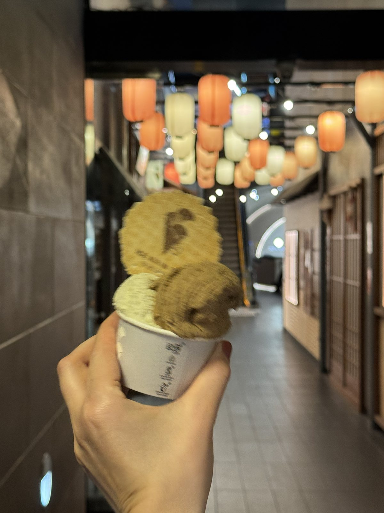

### 4. A Brief Sweetness, January 2026

*Digital photograph (iPhone 15 Pro Max), taken at 9:52 p.m.*  
*3,024 × 4,032 pixels. Collection of the artist.*

In a long arcade hung with paper lanterns, a hand lifts a cup of gelato toward the light. The two scoops and their round wafer are the only things in focus. Everything else, the lanterns, the corridor, the escalator rising out of sight at the far end, has gone soft, as if the world had agreed to step back for a moment and let this be the center of it.

The Dutch painters of the 1600s set guttering candles and half eaten fruit into their still lifes as reminders that pleasure and time move together. This picture is a vanitas in which the candle is a lantern and the fruit is gelato. The lanterns burn without warmth, the gelato melts without hurry, and the photograph holds both in the same instant.

It is the first work made after the crossing, on a summer night in early January in Sydney. A new city, a new hemisphere, and the first act of the new life is to hold something sweet up to the light before it disappears. The museum considers this a reasonable philosophy.

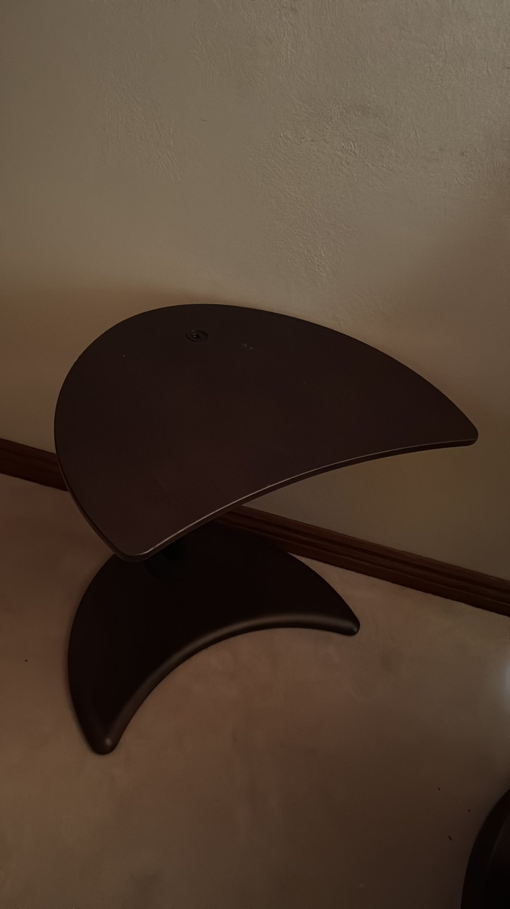

### 5. Two Crescents (Undecided), January 2026

*Digital photograph (iPhone 15 Pro Max), ISO 3200*  
*2,160 × 3,840 pixels. Collection of the artist.*

Two dark crescents project from a pale wall, one above the other, curving toward each other without touching. The light is low and the grain is heavy, so that the forms seem less like objects than like shadows that have decided to stay. Their function is unknown. They hold nothing. They may once have held something.

Jean Arp believed art should grow in a person the way fruit grows on a plant, without needing to be explained. Mark Rothko, in his late paintings, stacked dark shapes on darker grounds until their edges seemed to breathe. These crescents belong to the same family of quiet presences: things that do not tell you what they are for, and wait for you to stop asking.

Jean-Paul Sartre wrote that for human beings, existence precedes essence: we are here first, and only afterward decide what we are for. The crescents appear to be in the middle of that decision. So, in the second week of January, in a new city, was the artist. The museum leaves both undecided.

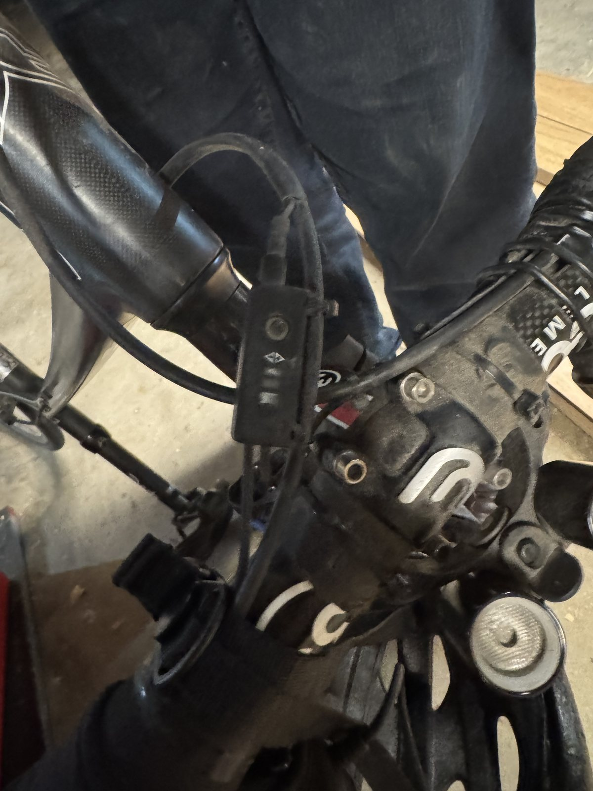

### 6. Brake, Night, February 2026

*Digital photograph (iPhone 15 Pro Max, ultra wide lens), ISO 1250, taken at 9:59 p.m.*  
*3,024 × 4,032 pixels. Collection of the artist.*

The rider's view at ten at night: a brake lever, a grip, a knot of cables, the dull shine of a hub, and at the edge a knee in dark denim. The ultra wide lens bends the handlebar into an arc, as though the bicycle were curling around the person who will ride it. Nothing in the picture is moving yet.

In 1913 Marcel Duchamp fixed a bicycle wheel upside down to a stool and set it spinning in his studio, a wheel that turned and went nowhere. He said he enjoyed looking at it the way one enjoys watching flames in a fireplace. The artist's bicycle is his wheel reversed: it is still, and it is about to go somewhere.

The brake is the most philosophical part of any machine. It exists only to say no: to stop, to hold back the thing that wants to continue. The picture is taken with a hand near the lever, at the hour when most people are already home. The museum cannot say whether the artist was about to leave or had just arrived. It suspects the artist could not have said either.

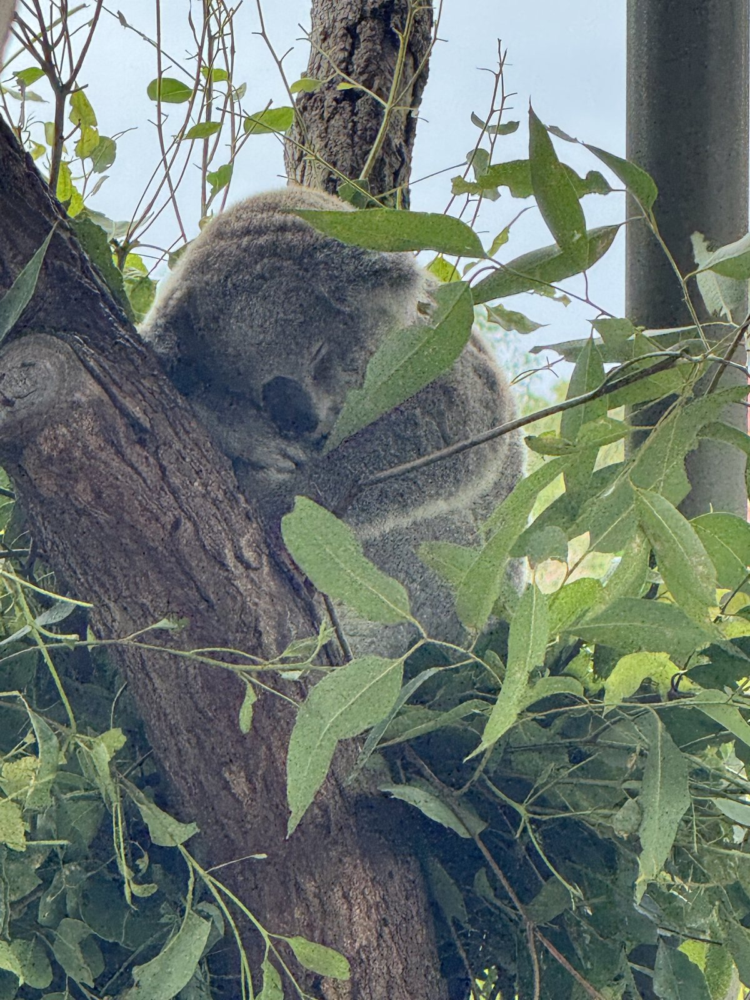

### 7. Sleeper, February 2026

*Digital photograph (iPhone 15 Pro Max, telephoto lens), taken at 4:17 p.m.*  
*3,024 × 4,032 pixels. Collection of the artist.*

In the fork of a eucalyptus tree, a koala sleeps with its face pressed into its own grey fur, arms around the trunk. Long leaves surround it in a loose green halo, lit from behind by the afternoon. Beside the tree stands a grey pole, plain and upright, belonging to the city. The animal has chosen this branch, with this view, and closed its eyes on all of it.

In the 1600s Blaise Pascal wrote that all of humanity's problems stem from our inability to sit quietly in a room alone. The koala has no such problem. It spends most of the day asleep, and appears to feel no obligation to explain itself, to be productive, or to be photographed.

The artist uses the telephoto lens to come close without disturbing anything, which may be the most respectful gesture in the exhibition. Of all the figures in this show, the koala alone has made peace with the passing of time, by declining to watch it pass. The museum regards it with something close to envy.

---

## Five Hours
*March 5, 2026*

This room covers a single afternoon in Bali, between 1:15 and 6:22. In five hours the artist moved from power lines and an empty lot to a corner covered in other people's names, and finally to a temple wall as the light went. Read the room in order. It is a small life in itself: noise, emptiness, the wish to leave a mark, and then something older that asks for silence.

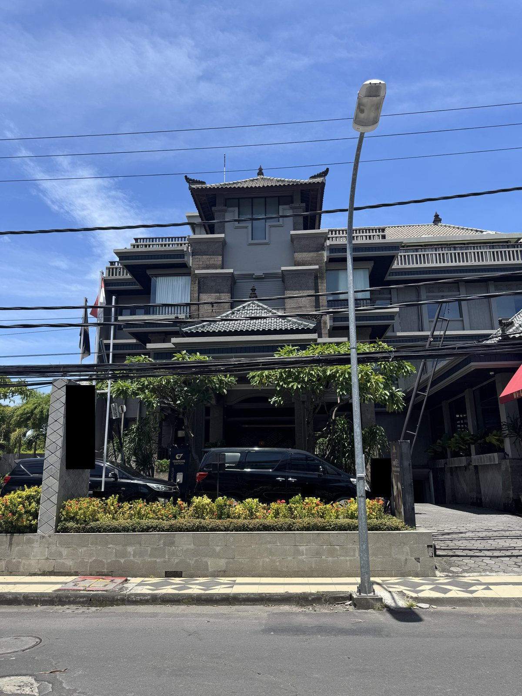

### 8. Building, through Wires, March 2026

*Digital photograph (iPhone 15 Pro Max), 1/2833 second, taken at 1:15 p.m. Details redacted for public display.*  
*4,284 × 5,712 pixels. Collection of the artist.*

A dark building with tiered roofs stands behind a net of overhead cables at 1:15 on a bright afternoon. A streetlamp rises in front of it, two black cars wait in the drive, and a band of yellow flowers runs along the wall. The sky is high, clear and very blue. Nothing in the picture is out of place, and nothing in it is quite visible.

The photographer Lee Friedlander spent decades letting poles and wires interrupt his pictures, refusing to wait for the clean view that never comes. The artist accepts the same arrangement. The building is the subject. The wires are the condition. One never sees anything except through something else.

This is the first of four photographs made on a single afternoon in Bali, between 1:15 and 6:22. It begins the shortest period in the artist's life and one of the most attentive. Five hours, four pictures. The museum notes that this is roughly the span of a day's real attention in any life, and that most days do not leave four pictures behind.

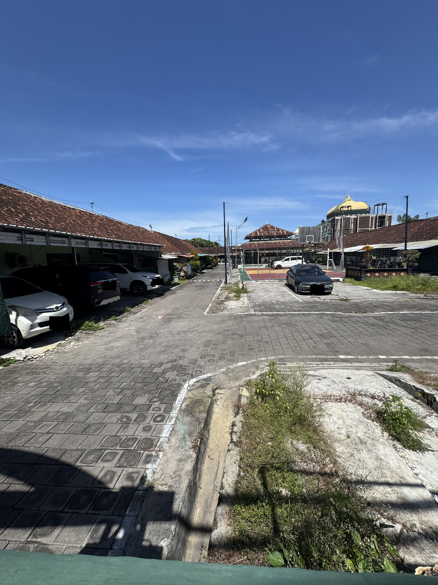

### 9. Lot, Midafternoon, March 2026

*Digital photograph (iPhone 15 Pro Max, ultra wide lens), taken at 2:09 p.m. Number plates redacted for public display.*  
*3,024 × 4,032 pixels. Collection of the artist.*

An empty paved lot stretches under an enormous sky. Red tile roofs line one side, a few cars rest in their shade, and far away a golden dome catches the sun. In the foreground, a broken curb and a strip of weeds lead nowhere in particular. It is 2:09 in the afternoon, the hour when shadows are shortest and there is the least to hide behind.

In 1975 the New Topographics photographers turned their cameras on parking lots, warehouses and tract houses, insisting that the places people actually build deserve the attention we give to mountains. Their pictures are flat and patient and refuse to be beautiful. They are also, if you stand in front of them long enough, strangely moving.

The lot is a space designed for arriving and leaving, and almost no one is doing either. The weeds have begun to take back the edges, slowly, without asking. The artist stood in the heat long enough to take a picture, which is to say long enough to be, briefly, the only thing in the lot that was paying attention.

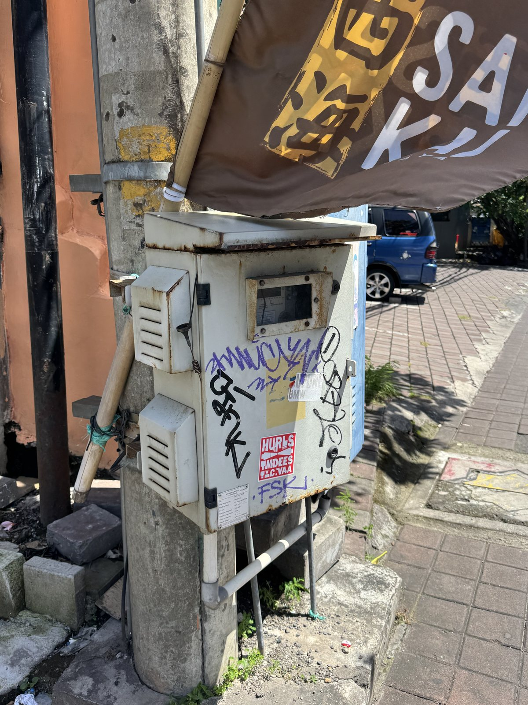

### 10. I Was Here (Box, Pole, Banner), March 2026

*Digital photograph (iPhone 15 Pro Max), taken at 2:11 p.m.*  
*4,284 × 5,712 pixels. Collection of the artist.*

Two minutes later, the artist turns to a crowded corner. A metal box strapped to a pole is covered in tags, layered and overlapping and half legible, written by hands that never met. Above, the corner of a banner flaps into the frame. The sidewalk runs away to the right into bright shade.

Every tag is a person saying, in the plainest possible terms, I was here. In the late 1970s Jean-Michel Basquiat wrote cryptic messages signed SAMO across the walls of New York before carrying the same urgent handwriting onto canvas. The box carries no message as clear as his, and every message at once: a name, another name written over it, and the weather slowly erasing both.

Beside the empty lot made two minutes earlier, the picture completes a pair. One shows a surface no one has marked. The other shows a surface everyone has. Both, the museum suggests, answer the same question: what does it mean to leave a trace on a world that will not keep it? The artist's answer, characteristically, was to take a photograph.

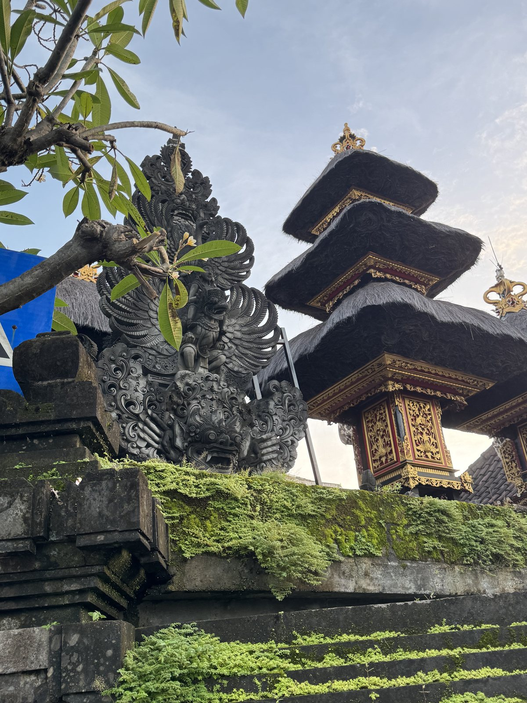

### 11. Guardian and Tiered Roofs, Evening, March 2026

*Digital photograph (iPhone 15 Pro Max), taken at 6:22 p.m.*  
*4,284 × 5,712 pixels. Collection of the artist.*

In the soft light of early evening, a carved stone guardian rises from a temple wall, dense with ornament and darkened by age. Behind it, tiered thatched roofs, the shrines called meru, stack toward a pale sky. Moss covers the top of the wall, and a frangipani branch reaches in from the edge of the frame.

The stone was carved by hands working in a tradition far older than the camera, and far older than the questions this exhibition likes to ask. The moss has been growing on it for longer than the artist has been alive. Whatever the guardian keeps watch over, it has been doing so patiently, in every weather, without needing to be seen.

This is the last of the four works made in Bali on that afternoon in March. The day began with wires and an empty lot and ends here, as the light goes, in front of something made to last. The museum lowers its voice for this one, and invites the visitor to do the same.

---

## The Waiting Months
*April to June 2026*

Between journeys, the artist photographed a crate being filled for the next departure. This is the room of preparation, the long middle where most of any year is spent. Look at what has been chosen, and at what was left out.

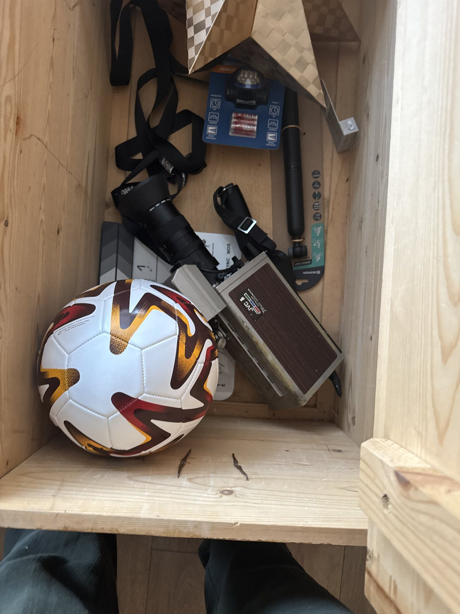

### 12. What to Bring, June 2026

*Digital photograph (iPhone 15 Pro Max), taken at 4:03 p.m.*  
*3,024 × 4,032 pixels. Collection of the artist.*

Looking down into a raw pine crate: a white football with flame markings, a camera monitor, a tangle of straps and cables, a headlamp, a torch, and the point of a woven paper star. Below the crate, the artist's knees. The light is warm and even. Two small dark specks rest on the floor of the box, the only things in it that were not chosen.

Joseph Cornell spent decades arranging small objects in wooden boxes, marbles and maps and paper birds, building whole worlds out of what would fit. His boxes are tender and slightly unbearable, because they show how much a person can love and how little a person can carry.

This crate is a working version of the same idea. What do you bring, when you cannot bring everything? The artist's answer, in early June, was a ball, a light, a camera and a star: something to play with, something to see by, something to remember with, and something for no reason at all. The museum finds the last the most persuasive.

---

## One Day in July
*July 15, 2026*

Two pictures from the same day in Vanuatu, five hours apart. The first is the most familiar image in the exhibition: palms, water, a low sun. The second is the least: a moth on a wall in the dark. Stand between them and decide which one the day was really about. The museum has its suspicions.

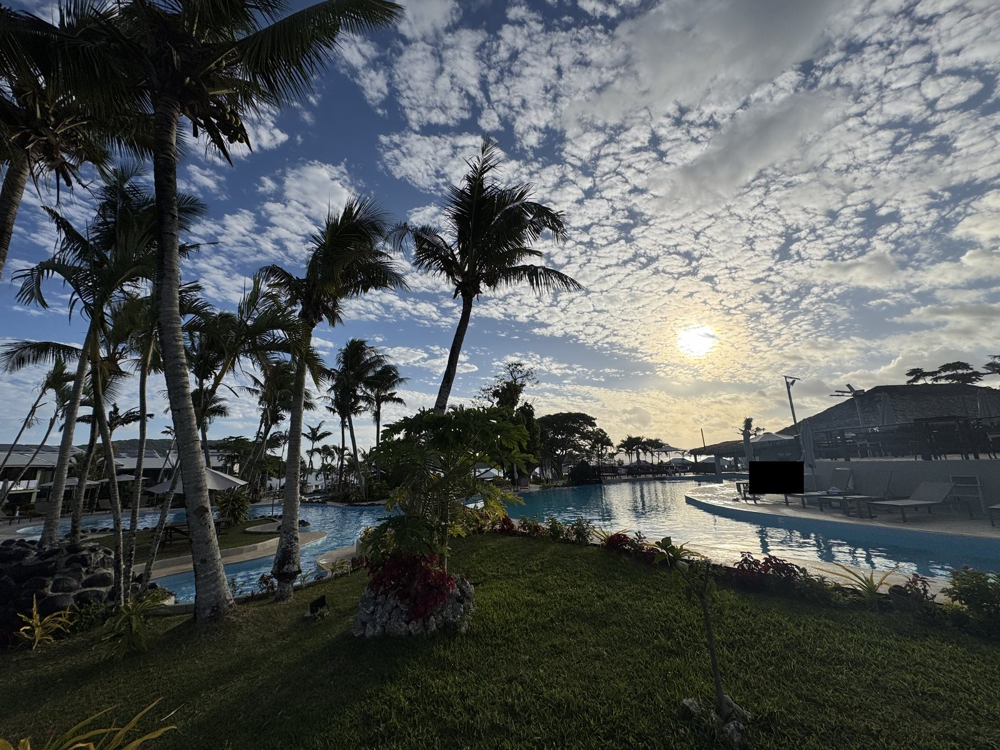

### 13. Is This It (Palms, Pool, Sun), July 2026

*Digital photograph (iPhone 15 Pro Max, ultra wide lens), 1/5650 second, taken at 4:15 p.m. A figure and details redacted for public display.*  
*4,032 × 3,024 pixels. Collection of the artist.*

The only landscape format work in the exhibition opens wide: palms leaning in, a lawn dotted with red flowers, a curving lagoon pool, and the sun burning low through a sky full of small clouds. The exposure lasts a fraction of a millisecond, and the trees have gone nearly black against the glare. It is 4:15 in the afternoon in Vanuatu.

This is the picture of paradise, and it is very old. Paul Gauguin sailed to Tahiti in 1891 to find it, and painted it as untouched, which it was not. Vanuatu, where this was made, was governed jointly by Britain and France until its independence in 1980. Paradise has always been somewhere that someone else lives.

The artist stands at the edge of the lawn with everyone's idea of happiness laid out in front of them: sun, water, palms. It is genuinely beautiful. It also has a filtration system. Camus wrote that one must imagine Sisyphus happy. The museum suggests one must also imagine the person at the edge of paradise, wondering quietly whether this is it.

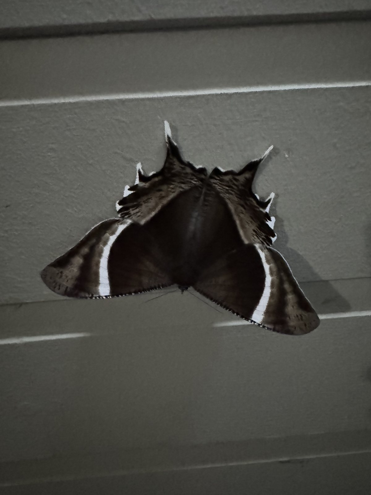

### 14. Moth, Nine O'Clock, July 2026

*Digital photograph (iPhone 15 Pro Max, ultra wide lens), ISO 2500, taken at 9:01 p.m.*  
*3,024 × 4,032 pixels. Collection of the artist.*

A large moth rests flat against a pale wall, wings spread in perfect symmetry, dark brown crossed by a bright white band, the edges scalloped like torn paper. It is nine at night and the camera has had to strain to see it. The grain is heavy. The moth is completely still.

Moths fly toward light, and for centuries people said they were drawn to it. Recent research suggests something stranger: confused by any bright thing, they tilt their backs toward it as if it were the sky. Either way, they come, and they stay. In 1921 Hermann Rorschach asked people what they saw in symmetrical inkblots. This shape asks the question back.

Made five hours after the palms and the pool, the work shows the other side of the same day. The moth came to the light. The artist came to the moth. For a moment, on a wall in Vanuatu, two creatures who did not entirely know why they were there regarded each other, and one of them took a picture.

---

## Above
*September 1, 2026*

The final room holds a single work: the coast, seen from a small plane on the first morning of spring. After a year spent looking down at floors and crates and carpets, the artist looks down at everything at once. It does not answer anything. It is simply very large, and very blue, and seen through glass.

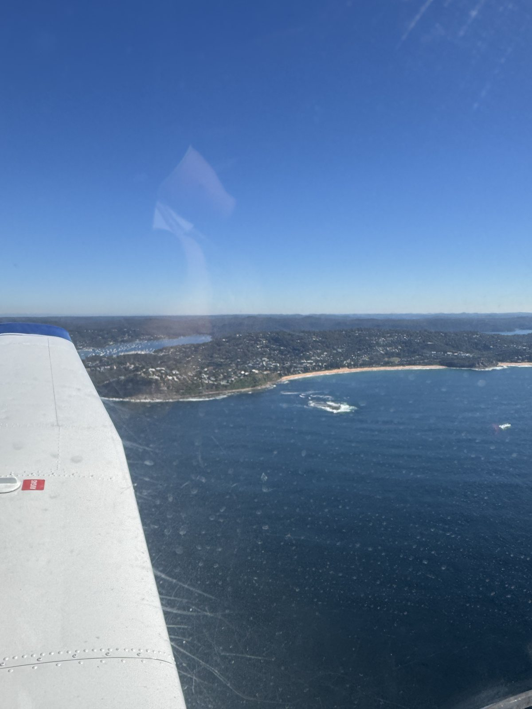

### 15. Above (Wing, Coast, Morning), September 2026

*Digital photograph (iPhone 15 Pro Max, ultra wide lens), taken at 10:18 a.m.*  
*3,024 × 4,032 pixels. Collection of the artist.*

From the window of a small aircraft, the coast unrolls below: headlands, bays, a ribbon of beach, green suburbs climbing the hills, and deep blue water marked with white. The wing, white with a single red stripe, cuts into the lower left. Scratches on the window catch the sun, and a faint reflection of the cabin hangs in the sky like a ghost.

In 1858 the photographer Nadar rose in a balloon over Paris and made what are often called the first aerial photographs. From above, the city became a pattern, and everyone in it too small to see. Every view from above is a little like that. Everything is visible, and nothing is close.

This is the last work in the exhibition, made on the first morning of spring. The year began with a dog digging into a bed, and ends with the whole coast at once, seen through scratched glass. The artist has risen above all of it, and is still, unmistakably, inside something. The plane will land. The next exhibition is already being made.

---

## The Artist's Life

- **December 2025: Before Leaving.** A dog, a floor, a case.
- **January to February 2026: Arrival.** A new hemisphere. Something sweet, something undecided, a brake, a sleeper.
- **March 5, 2026: Five Hours.** One afternoon. Four pictures. Wires, an empty lot, a tagged box, a temple at dusk.
- **April to June 2026: The Waiting Months.** A crate of chosen things.
- **July 15, 2026: One Day in July.** Paradise at four. A moth at nine.
- **September 1, 2026: Above.** The first morning of spring, seen from the air.

---

*You do not have to read everything. You do not have to understand it. You were here, and you looked. That is most of it.*
